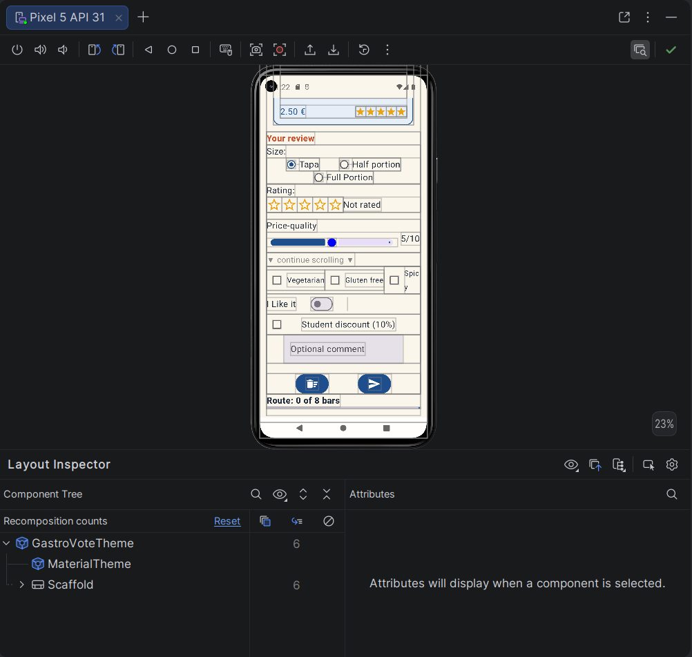
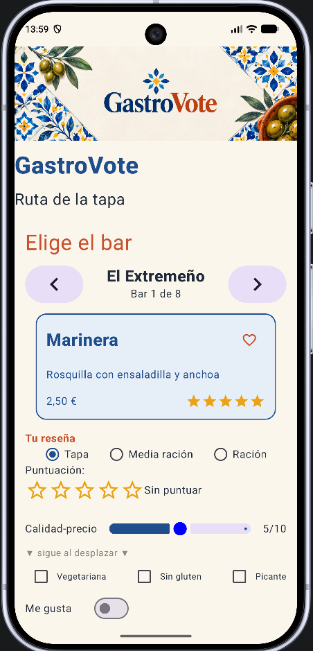
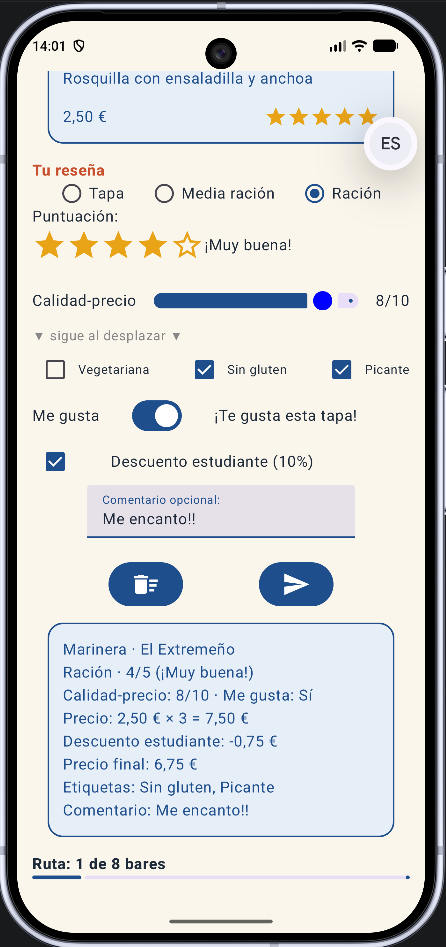
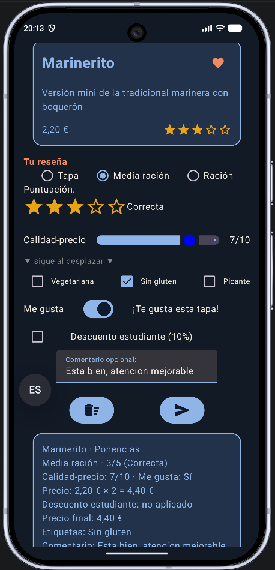
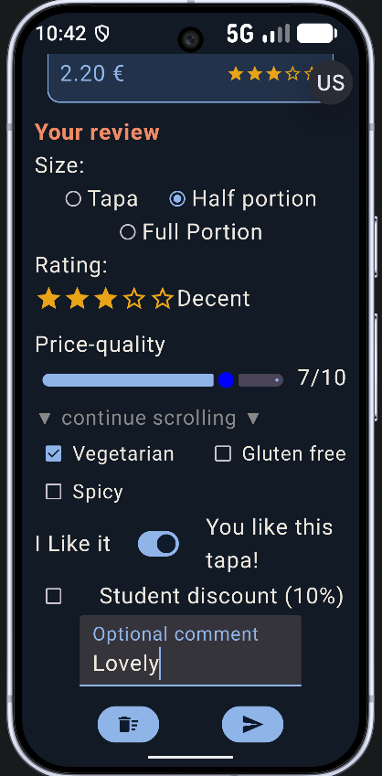
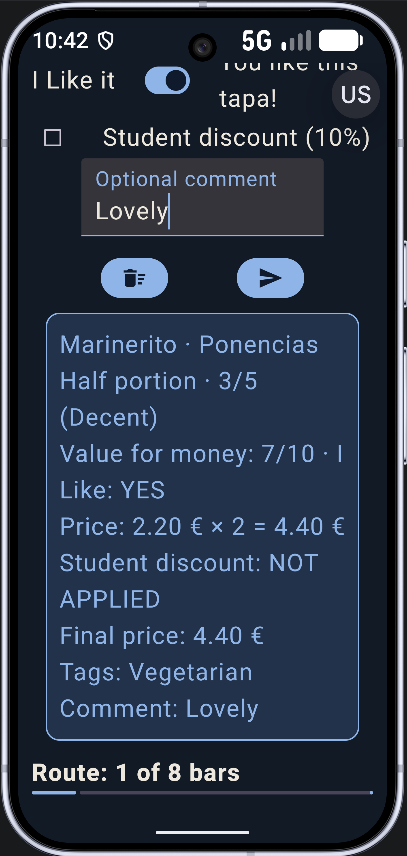
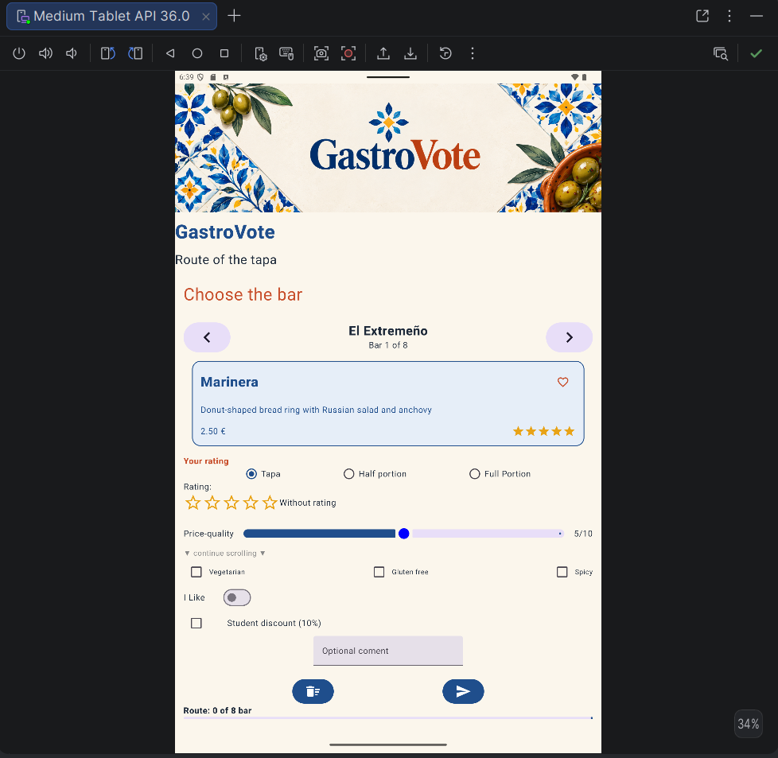
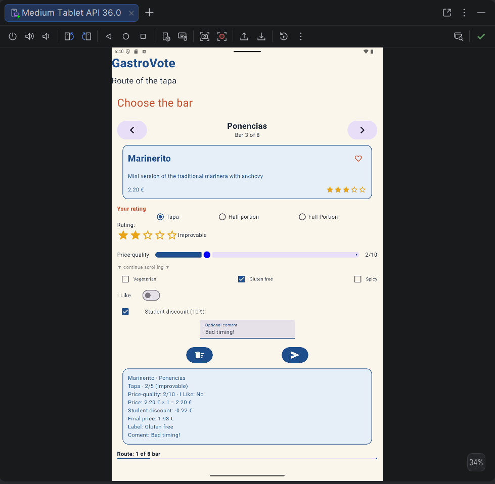
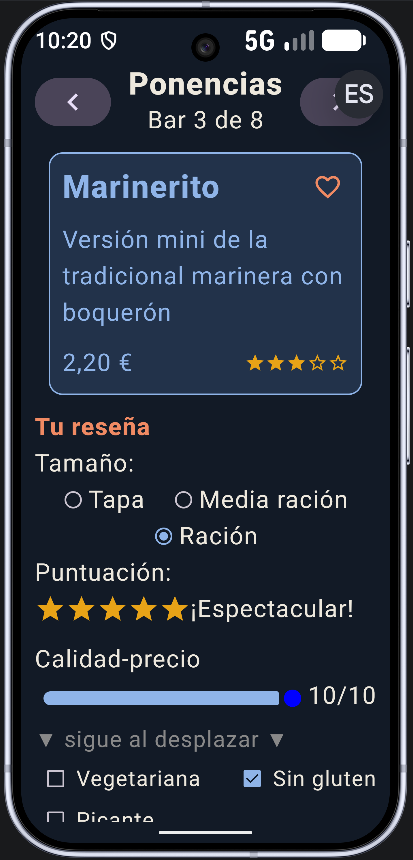

# GastroVote

## 1. Descripción del proyecto

**GastroVote** es una aplicación móvil Android desarrollada en Kotlin con Jetpack Compose, cuyo objetivo es permitir a los usuarios valorar las tapas de diferentes establecimientos que participan en una ruta gastronómica.

La aplicación permite consultar información sobre ocho bares, seleccionar tapas, publicar reseñas y llevar un seguimiento del progreso de la ruta.

## 2. Tecnologías utilizadas

- **Lenguaje:** Kotlin.
- **Interfaz:** Jetpack Compose y Material Design 3.
- **Entorno de desarrollo:** Android Studio.
- **SDK mínimo:** API 24 (verificar en Gradle).
- **Control de versiones:** Git y GitHub.

## 3. Funcionalidades de GastroVote

### Catálogo de bares

La aplicación dispone de ocho bares que pueden recorrerse mediante dos botones de navegación.

Cada establecimiento tiene una ficha con información sobre su tapa, descripción, precio y puntuación media.

### Sistema de favoritos

El usuario puede marcar o desmarcar cada bar como favorito pulsando sobre el icono del corazón.

### Publicación de reseñas

El formulario permite:

- Seleccionar entre tapa, media ración y ración.
- Valorar la tapa de 0 a 5 estrellas.
- Puntuar la relación calidad-precio de 0 a 10.
- Seleccionar las etiquetas vegetariana, sin gluten y picante.
- Indicar si le ha gustado la tapa.
- Aplicar un descuento de estudiante del 10 %.
- Escribir un comentario opcional de hasta 200 caracteres.

### Cálculo del precio

El precio se calcula según el tamaño seleccionado:

| Tamaño | Multiplicador |
|---|---|
| Tapa | ×1 |
| Media ración | ×2 |
| Ración | ×3 |

Si el usuario selecciona el descuento de estudiante, se aplica un 10 % al precio calculado.

### Resumen de la última reseña

Al publicar una reseña válida, se guarda la información en un objeto `ReseñaPublicada`.

El resumen muestra los datos guardados y no cambia cuando el usuario modifica posteriormente el formulario.

### Progreso de la ruta

Una barra de progreso representa cuántos de los ocho bares han sido reseñados.

Publicar varias reseñas de un mismo establecimiento no aumenta el progreso.

## 4. Funcionamiento de la aplicación

1. El usuario abre GastroVote y selecciona un bar.
2. Consulta la ficha de la tapa disponible.
3. Completa el formulario de valoración.
4. Pulsa «Publicar reseña».
5. La aplicación valida la puntuación, calcula el precio y muestra el resumen.
6. La barra de progreso se actualiza cuando se reseña un establecimiento nuevo.

El botón «Limpiar» permite restablecer el formulario mediante un diálogo de confirmación.

## 5. Entrega 1 — UT2

### 5.1. Objetivo

En esta primera entrega se desarrolla la interfaz principal de GastroVote, incorporando los componentes de Jetpack Compose trabajados en la UT2.

### 5.2. Componentes utilizados

- `Column` y `Row`: organización de la interfaz.
- `Card`: fichas y resumen de reseñas.
- `Button`: navegación y acciones.
- `RadioButton`: selección del tamaño.
- `Checkbox`: etiquetas y descuento.
- `Switch`: valoración de «Me gusta».
- `Slider`: calidad-precio.
- `TextField`: comentario del usuario.
- `AlertDialog`: confirmación de limpieza.
- `LinearProgressIndicator`: progreso de la ruta.
- `verticalScroll`: desplazamiento vertical.

### 5.3. Gestión de estados

Se utilizan `remember`, `mutableStateOf` y `mutableStateListOf` para gestionar la información durante la ejecución.

La clase `ReseñaPublicada` almacena una copia de los datos al publicar, evitando que los cambios posteriores del formulario alteren el resumen.

### 5.4. Pruebas realizadas

Rellenar esta tabla después de ejecutar las comprobaciones.

| Prueba | Resultado | Observaciones |
|---|---|---|
| Móvil pequeño, vertical | Pendiente | |
| Tablet, vertical | Pendiente | |
| Tema claro | Pendiente | |
| Tema oscuro | Pendiente | |
| Idioma español | Pendiente | |
| Idioma inglés | Pendiente | |
| Tamaño de fuente máximo | Pendiente | |
| Navegación circular de bares | Pendiente | |
| Publicación sin estrellas | Pendiente | |
| Precio con cada tamaño | Pendiente | |
| Precio con y sin descuento | Pendiente | |
| Publicación repetida del mismo bar | Pendiente | |
| Cancelación del diálogo de limpieza | Pendiente | |

### 5.5. Layout Inspector

**Problema detectado.** En un Pixel 5, la etiqueta «Picante» se partía letra a letra y «Ración» se cortaba en dos líneas.

**Cómo se localizó.** Con el Layout Inspector de Android Studio se vieron los bordes de cada elemento: las tres casillas de etiquetas estaban en un `Row`, y la última recibía solo el ancho que sobraba, demasiado estrecho para su texto. Un `Row` nunca pasa a la línea siguiente.

**Solución aplicada.** Se cambió el `Row` por un `FlowRow`, que pasa a la línea siguiente cualquier elemento que no quepa entero. Se aplicó lo mismo a las opciones de tamaño.

**Resultado.** Las etiquetas y los tamaños bajan completos a una segunda línea cuando no caben, también con la fuente al máximo.

.

### 5.6. Capturas de pantalla

**Móvil · tema claro · español**

| Pantalla principal | Reseña publicada |
|---|---|
|  |  |

**Modo oscuro e inglés**

| Modo oscuro | Inglés | Inglés · resumen |
|---|---|---|
|  |  |  |

**Tablet y fuente al máximo**

| Tablet | Tablet · reseña | Fuente al máximo |
|---|---|---|
|  |  |  |
### 5.7. Recursos gráficos

- **Banner:** imagen generada con ChatGPT (OpenAI) a partir de una descripción propia.
- **Icono de la aplicación:** icono por defecto de la plantilla de Android Studio.
- **Iconos de la interfaz** (flechas, estrellas, corazón, botones): [Material Icons](https://fonts.google.com/icons) de Google, con licencia Apache 2.0.

### 5.8. Control de versiones

El desarrollo se gestiona mediante Git y GitHub, utilizando commits para registrar los cambios.

- **Etiqueta:** `entrega1`
- **Release:** `Entrega 1 – UT2`

## 6. Cómo ejecutar GastroVote

1. Clonar el repositorio.
2. Abrir el proyecto desde Android Studio.
3. Esperar a que finalice la sincronización de Gradle.
4. Seleccionar un emulador o dispositivo Android compatible.
5. Ejecutar la aplicación.

## 7. Mejoras futuras

Como posibles ampliaciones se contempla:

- Reorganizar el proyecto siguiendo la arquitectura MVVM.
- Incorporar persistencia de datos.
- Añadir nuevas funcionalidades de consulta y valoración de tapas.
